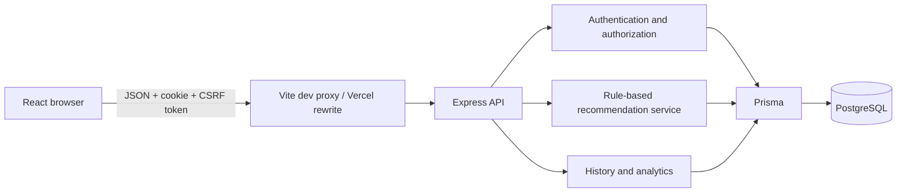
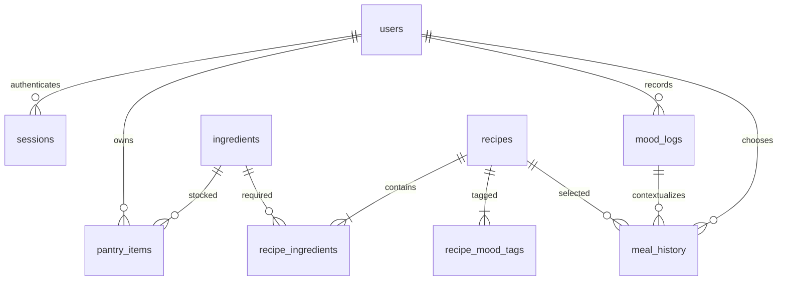
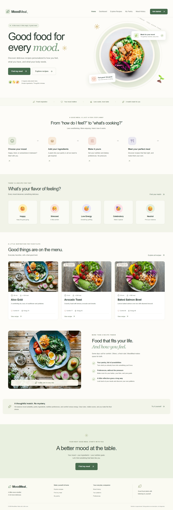

# MoodMeal

**Good food for every mood.** A full-stack recipe and nutrition recommender that combines your manually selected mood, pantry ingredients, and nutrition preferences. Created from the supplied professional training report and presentation; see [reference analysis](docs/REFERENCE_ANALYSIS.md).

**Live website:** [MoodMeal on Vercel](https://moodmeal-kishore0696.vercel.app). The frontend connects to an Express API on Render and PostgreSQL on Neon. Free-tier backend wake-up can delay the first request after inactivity.

## Features

- Responsive food discovery homepage, searchable/paginated recipe catalog, and recipe details.
- Email/password registration and login, persistent database sessions, profile/preferences editing.
- Five manual mood categories, ingredient autocomplete, persistent pantry CRUD.
- Deterministic recommendations with component scores, missing ingredients, and explanations.
- Hard dietary restrictions applied before ranking, optional calorie/protein preferences and time limit.
- 42 Indian and international recipes with quantities, steps, approximate nutrition, comfort and energy scores.
- Persistent mood-to-meal history, date/mood filters, and snapshot nutrition.
- Recharts mood frequency, meal frequency, favorite recipes, daily meal counts, and comfort/energy trends, all from saved data.
- Role-protected recipe create/read/update/archive interface at `/admin`.

## Stack and architecture

React 19, TypeScript, Vite, Tailwind CSS 4, React Router, Lucide, Motion, Recharts. Node.js 24, Express 5, Zod, bcrypt, Prisma 6, PostgreSQL. Frontend deployment target: Vercel; backend: Render; managed database: Neon.



Frontend uses `/api` by default. In production, Vercel forwards `/api/*` to Render, keeping cookies first-party. Backend always validates the frontend Origin and CSRF token on authenticated mutations. Independent backend requests use exact CORS origin matching. All private queries are scoped to the authenticated user.

## Database design



See `backend/prisma/schema.prisma` and committed SQL migration. Unique normalized ingredient names and user/ingredient pairs prevent duplicate pantry items. Foreign keys preserve relations. History stores an immutable nutrition/scoring snapshot; catalog deletion is archival. Session tokens are random 256-bit values stored as SHA-256 hashes, with expiry indexes.

## Local development

Requirements: Node.js 24 and npm 11. PostgreSQL may be external, installed locally, Docker-based, or the optional bundled development runtime. Do not use the bundled runtime for hosting.

```sh
npm ci
npm run db:generate
npm run db:local
```

Leave the database terminal running. On first start, `db:local` initializes PostgreSQL on loopback port 54329, creates development and isolated test databases, generates a random password in ignored `.local/`, and writes `backend/.env` only if missing. If you already have PostgreSQL, copy `backend/.env.example` to `backend/.env` and configure your own URLs instead.

In another terminal:

```sh
npm run db:migrate
npm run db:seed
npm run dev
```

Open `http://localhost:5173`. The API listens on port 4000. Always use `localhost` in the browser because it must match `FRONTEND_ORIGIN`; `127.0.0.1` is a different origin. Local Vite proxies API calls to Express. Health endpoint: `http://localhost:4000/api/health` checks the database.

For future schema changes, use `npm run db:dev -w backend -- --name descriptive_change`. Commit the generated migration; deployment uses `migrate deploy`, never `db push`.

## Configuration

| Variable | Location | Purpose |
|---|---|---|
| DATABASE_URL | Backend only | PostgreSQL application connection; Neon pooled URL in production |
| DIRECT_URL | Backend only | Direct PostgreSQL connection for migrations |
| PORT | Backend | Defaults to 4000; Render supplies it |
| NODE_ENV | Backend | development, test, production |
| FRONTEND_ORIGIN | Backend | Exact allowed browser origin, no trailing slash |
| COOKIE_SAME_SITE | Backend | lax for first-party proxy; none for direct cross-site HTTPS |
| SESSION_DAYS | Backend | Session lifetime, default 7, maximum 30 |
| RECOMMENDATION_WEIGHTS | Backend | Mood, ingredients, nutrition, comfort/energy; defaults `.35,.30,.20,.15` |
| VITE_API_URL | Frontend, public | `/api` recommended; never put secrets in VITE variables |
| TEST_DATABASE_URL | Tests only | Isolated PostgreSQL database ending `_test` |

No session signing secret is required: opaque tokens are generated with Node crypto and checked against hashed database records. The server rejects insecure production frontend origins. Production session cookies are Secure, HttpOnly, host-only, with configured SameSite behavior.

## Recommendation logic

`S = .35 M + .30 I + .20 N + .15 C`, normalized to a displayed 0–100 score. Restrictions and maximum time exclude incompatible recipes before scoring. Full component definitions and design choices are in [REFERENCE_ANALYSIS.md](docs/REFERENCE_ANALYSIS.md). Match scores are heuristic compatibility, not probabilities or medical advice. Ingredient matching checks presence, not quantity sufficiency. Mood is always manually selected.

## Tests and builds

```sh
npm test
node scripts/integration.mjs
npx playwright install chromium
npm run test:e2e
npm run build
```

`npm test` runs unit tests; database integration tests are explicitly skipped unless `TEST_DATABASE_URL` is provided. The local integration helper reads the ignored local password, migrates/seeds `moodmeal_utf8_test`, and runs all backend tests. With an external test database, migrate and seed it first and run `npm test` with its URL in `TEST_DATABASE_URL`. Integration tests remove only their generated accounts; browser tests retain uniquely named demo accounts so persistent history can be inspected. Never run tests against production.

The Playwright workflow registers, selects a mood, adds pantry items, saves preferences, gets recommendations, chooses a meal, reloads history, opens analytics, logs out and signs back in. The PostgreSQL server must be running; Playwright starts frontend/backend automatically if needed. See [VERIFICATION.md](docs/VERIFICATION.md) for observed results and limits.

## Administrator setup

There are no hardcoded admin accounts. Register normally, then have a database operator run a parameterized role update, or use the provided utility:

```sh
npm run admin -w backend -- registered-admin@example.com
```

This is an operator-only local command using backend database credentials. It does not expose a public promotion endpoint. The user can then visit `/admin` to create or edit a recipe using validated structured JSON. Clone an existing recipe's fields as a template and use a unique slug for new entries. Archive removes it from recommendations while retaining historical meals.

## Deployment

Follow [DEPLOYMENT.md](DEPLOYMENT.md). Replace the explicit Render-host placeholder in `frontend/vercel.json` with the actual backend hostname. No hosted URL is claimed by this repository. GitHub/hosting account authorization is needed before publishing.

## Actual interface screenshots

Captured from the running application with bundled illustrative photographs:



Mobile screenshot: [home-mobile.png](docs/screenshots/home-mobile.png).

## Data and operations

Nutrition and mood suitability are approximate editorial data. Food photos are illustrative Unsplash images under the [Unsplash license](https://unsplash.com/license); the bundled SVG fallback is original. Review dietary metadata and ingredient packaging for suitability and cross-contact. Analytics are descriptive, never diagnostic. Rate limits are per API process; use one Render instance for this configuration and add a shared limiter store before scaling horizontally. Schedule expired-session cleanup with your database maintenance process. Back up PostgreSQL and test restoration before releases.

Future improvements: richer recipe-specific licensed photography, audited ingredient/allergen taxonomy, account recovery and email verification, ingredient quantity matching, grocery lists, larger-dataset performance testing, and managed multi-instance rate limiting.
